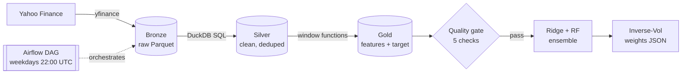

# Market Volatility Lakehouse

> A production-style **data engineering pipeline** that ingests market data, models it through a medallion architecture, validates it with quality gates, and serves volatility forecasts and portfolio weights, orchestrated by Airflow.

Engineering sequel to my PFE ([FST Al Hoceima](https://github.com/safwanov/Projet-machine-learning)), where the same use case lived in a single notebook. Here the focus is the **platform around the model**.

## Architecture



| Layer | Tech | Responsibility |
|---|---|---|
| Bronze | Python, yfinance, Parquet | Raw, append-only, partitioned by ticker, stamped with `ingested_at` |
| Silver | DuckDB SQL | Typing, filtering, dedup via `QUALIFY ROW_NUMBER()` (latest ingestion wins) |
| Gold | DuckDB window functions | Rolling 5d/21d annualised vol, range, vol ratio, forward 5d target |
| Quality | SQL assertions | Uniqueness, nulls, price sanity, outlier returns, freshness. Failure halts the DAG |
| Serving | scikit-learn | Chronological split with leakage gap, Ridge + Random Forest ensemble, Inverse Volatility Weighting |
| Orchestration | Airflow (Docker) | `bronze >> silver_gold >> quality_gate >> serve`, retries, daily schedule |
| CI | GitHub Actions + ruff | Lint and compile on every push |

## Quickstart

```bash
make install
make run          # ingest -> transform -> quality -> serve  (writes data/serving.json)
make up           # Airflow UI on http://localhost:8080
```
## Results

Sample output of `make run` (`data/serving.json`), test set is the last 20% of history, chronological split with a 5-day gap.

**Forecast error (MAE on 5-day forward annualised volatility, lower is better)**

| Ticker | Ridge | Random Forest | Ensemble |
|---|---|---|---|
| TSLA | **0.1861** | 0.1897 | 0.1873 |
| SPY | **0.0558** | 0.0588 | 0.0563 |

**Latest forecast and allocation (Inverse Volatility Weighting)**

| Ticker | Forecast vol (5d, annualised) | Portfolio weight |
|---|---|---|
| TSLA | 45.4% | 16.7% |
| SPY | 9.1% | 83.3% |

**Takeaways**
- Ridge slightly beats Random Forest on both tickers, so the simple linear model is a strong baseline on these features. The ensemble sits between the two.
- The model correctly pushes weight toward the calmer asset: SPY gets about 5x the weight of TSLA.
- Next step: compare against a naive baseline (persistence: tomorrow's volatility equals the current 21-day volatility) to confirm the models add value.

## Design decisions

- **SQL for transforms, Python for I/O and ML**: transformations stay declarative, versionable and testable in the warehouse.
- **Idempotent ingestion**: one Parquet file per run date; Silver deduplicates, so re-runs never create duplicates.
- **Quality gate before serving**: bad data never reaches the model.
- **No look-ahead**: time-ordered split and a 5-day gap matching the target horizon.

## Roadmap

- [ ] Unit tests on synthetic data
- [ ] Migrate SQL to dbt models + tests
- [ ] Incremental loads instead of full refresh
- [ ] Dashboard on top of `serving.json`
- [ ] Data lineage and run metadata table
- [ ] Naive persistence baseline to benchmark the models

## Author

**safwanov (sazerov)**, Data Engineering and ML.
