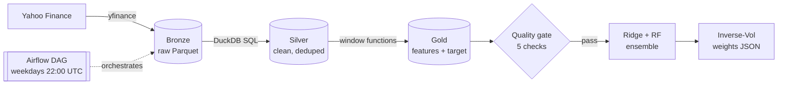

# Market Volatility Lakehouse

> A production-inspired **data engineering pipeline** that ingests market data, models it through a medallion architecture, validates it with quality gates, and serves volatility forecasts and portfolio weights, orchestrated by Airflow.

Engineering sequel to my final year project, where the same use case lived in a single notebook. Here the focus is the **platform around the model**.

## Architecture



| Layer | Tech | Responsibility |
|---|---|---|
| Bronze | Python, yfinance, Parquet | Raw, append-only, partitioned by ticker, stamped with `ingested_at` |
| Silver | DuckDB SQL | Typing, filtering, dedup via `QUALIFY ROW_NUMBER()` (latest ingestion wins) |
| Gold | DuckDB window functions | Rolling 5d/21d annualised vol, range, vol ratio, forward 5d target |
| Quality | SQL assertions | Uniqueness, nulls, price sanity, outlier returns, freshness. Failure halts the DAG |
| Serving | scikit-learn | Chronological split with leakage gap, Ridge + Random Forest ensemble, Inverse Volatility Weighting |
| Orchestration | Airflow (Docker) | `bronze >> silver_gold >> quality_gate >> serve`, 2 retries with backoff, weekdays at 22:00 UTC |
| CI | GitHub Actions + ruff | Lint and compile on every push |

## Quickstart

```bash
make install
make run          # ingest -> transform -> quality -> serve  (writes data/serving.json)
make up           # Airflow UI on http://localhost:8080
```
## Results

Sample output of `make run` on 14 Oct 2026 (`data/serving.json`). Test set is the last 20% of history, chronological split with a 5-day gap. Forecasts and weights change with each run because they use the latest market data.

**Forecast error (MAE on 5-day forward annualised volatility, lower is better)**

| Ticker | Ridge | Random Forest | Ensemble | Naive 5d | Naive 21d | Ensemble vs best naive |
|---|---|---|---|---|---|---|
| TSLA | **0.1862** | 0.1897 | 0.1874 | 0.2484 | 0.2054 | -8.8% error |
| SPY | **0.0512** | 0.0586 | 0.0542 | 0.0661 | 0.0662 | -18.0% error |

Naive baselines predict that future volatility equals the current 5-day or 21-day realised volatility.

**Latest forecast and allocation (Inverse Volatility Weighting)**

| Ticker | Forecast vol (5d, annualised) | Portfolio weight |
|---|---|---|
| TSLA | 42.8% | 24.1% |
| SPY | 13.6% | 75.9% |

**Takeaways**
- All models beat both naive baselines on both tickers. The ensemble cuts error by 8.8% (TSLA) and 18.0% (SPY) versus the best naive baseline.
- Ridge is the best model on both tickers. Random Forest adds no value on these features, and the ensemble is slightly worse than Ridge alone.
- Limitations: single chronological split (no walk-forward validation or significance test), and SPY error is still large relative to its volatility level.

## Design decisions

- **SQL for transforms, Python for I/O and ML**: transformations stay declarative, versionable and testable in the warehouse.
- **Idempotent ingestion**: one Parquet file per run date; Silver deduplicates, so re-runs never create duplicates.
- **Quality gate before serving**: bad data never reaches the model.
- **No look-ahead**: time-ordered split and a 5-day gap matching the target horizon.

## Roadmap

- [ ] Unit tests on synthetic data
- [ ] Migrate SQL to dbt models + tests
- [ ] Incremental loads instead of full refresh
- [ ] Dashboard on top of `serving.json`
- [ ] Data lineage and run metadata table
- [ ] Naive persistence baseline to benchmark the models

## Author

**safwanov**, Data Engineering and ML.
